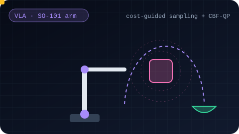
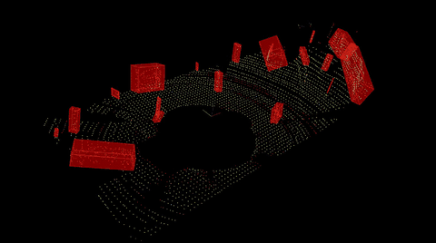
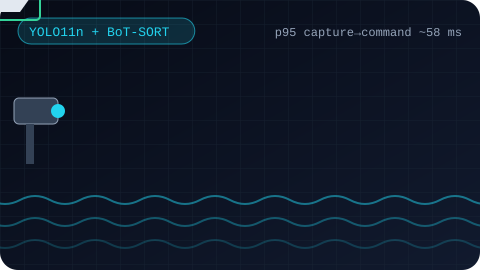
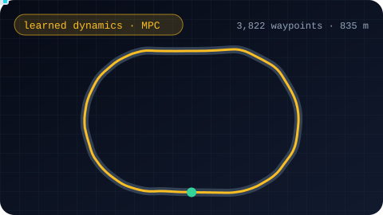
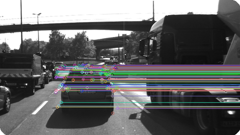
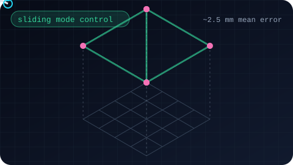

  

  
  
  
  

I'm a robotics engineer who likes the whole loop: taking messy sensor data — point clouds, camera frames, microphone audio — and turning it into a robot that understands what's around it and moves safely. I've built this for **self-driving cars, quadrotors, robot arms, pan-tilt trackers and on-device voice agents**, mostly in C++ and Python.

  

## 🛠️ Things I've built

<table>
<tr>
<td width="50%" valign="top">

<h3>🎙️ On-Device Voice Interface</h3>
A robot that hears you across a noisy room, turns to face you, does what you ask through validated LLM tool calls, and <b>stops the instant you say "stop"</b>. No cloud.
</td>
<td width="50%" valign="top">

<h3>🦾 Obstacle-Aware VLA Arm</h3>
Teaching a vision-language-action policy to dodge obstacles it never saw in training, by steering its sampler with live depth-based costs and a safety filter as backup.
</td>
</tr>
<tr>
<td width="50%" valign="top">

<h3>🛰️ LiDAR 3D Object Detection</h3>
Raw point clouds → ground removal → clusters → tracked 3D boxes. RANSAC, KD-tree and Euclidean clustering written from scratch in C++.
</td>
<td width="50%" valign="top">

<h3>🎯 Marine Pan-Tilt Tracker</h3>
A hobby-parts pan/tilt rig that spots a small boat and keeps it in frame with YOLO + tracking, while an Arduino guards the servos.
</td>
</tr>
<tr>
<td width="50%" valign="top">

<h3>🔊 edge_audio</h3>
Why run Whisper on music and fan noise? A microsecond-scale learned gate decides what's worth transcribing and skips about a third of the work.
</td>
<td width="50%" valign="top">

<h3>🚗 Learned Dynamics + MPC</h3>
A neural network learns how a car drives, then a model-predictive controller uses it to follow an 835 m path in simulation.
</td>
</tr>
<tr>
<td width="50%" valign="top">

<h3>👁️ Camera Feature Tracking</h3>
Tracking the car ahead frame-to-frame by benchmarking keypoint detectors and descriptors on real driving data.
</td>
<td width="50%" valign="top">

<h3>🚁 Sliding-Mode Quadrotor Control</h3>
A robust controller that flies a Crazyflie through waypoints with <b>~2.5 mm</b> mean tracking error.
</td>
</tr>
</table>

<b>🧪 More experiments: sensor fusion, drones, planning, RL, medical imaging</b>

 

- 📡 **Sensor fusion**: [LiDAR + camera 3D tracking](https://github.com/22by7-raikar/LiDAR_Camera_3D_Object_Tracking) · [UKF LiDAR/RADAR fusion](https://github.com/22by7-raikar/UKF_3D_LiDAR-RADAR_Fusion_Tracking)
- 🛸 **Aerial autonomy**: [attitude estimation, window perception and flying through trees](https://github.com/22by7-raikar/RBE595-Hands-On-Autonomous-Aerial-Robotics)
- 🧭 **Planning & driving**: [PlanTF driving-stack extension](https://github.com/22by7-raikar/PlanTF_Autonomous_Driving_Stack_Extension) · [planning in dynamic environments](https://github.com/22by7-raikar/Motion-Planning-in-Dynamic-Enviroment) · [motion planning](https://github.com/22by7-raikar/Motion-Planning) · [state estimation for self-driving cars](https://github.com/22by7-raikar/Coursera-State-Estimation-Localization-Self-Driving-Cars)
- 🧠 **Learning & vision**: [reinforcement learning](https://github.com/22by7-raikar/RBE-595-Reinforcement-Learning) · [panoptic segmentation](https://github.com/22by7-raikar/Panoptic_Segmentation) · [ultrasound images from CT volumes](https://github.com/22by7-raikar/Synthesizing-2D-Ultrasound-Images-from-3D-CT-Volume)

## 🧰 Toolbox

  

<i>Robots that work outside the lab are my favorite kind. If you're building one, let's talk. 🤖</i>

