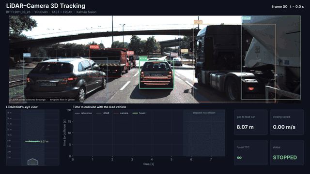
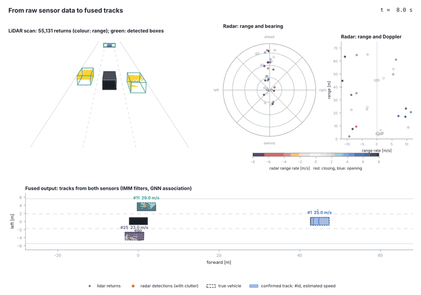
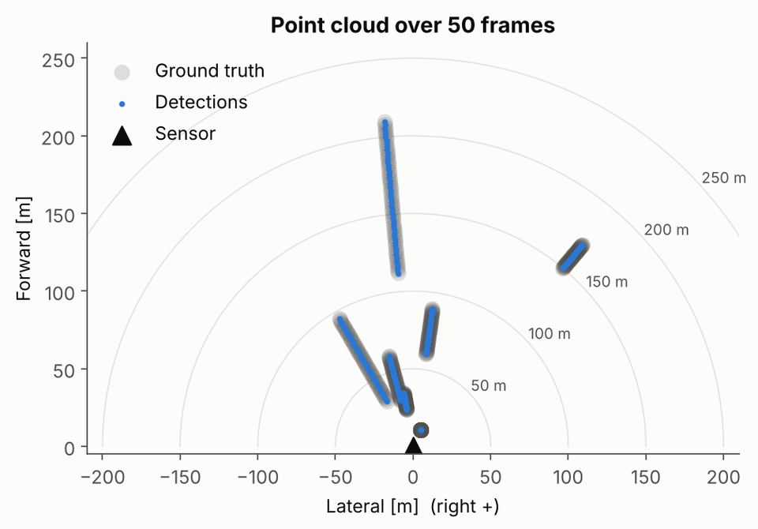
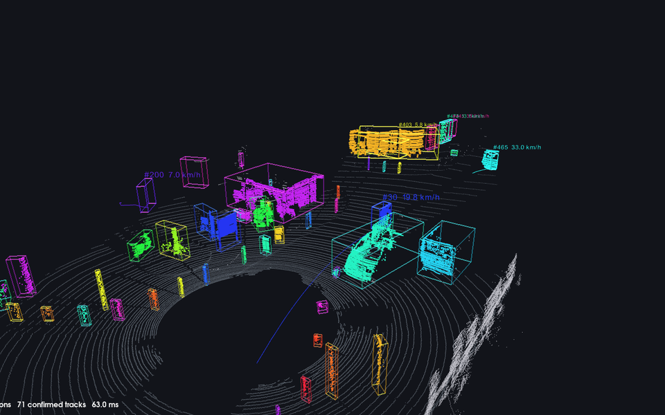

## Anuj Pai Raikar

**Robotics engineer: perception, sensor fusion and state estimation for autonomous systems.**

[Website](https://22by7-raikar.github.io) · [LinkedIn](https://www.linkedin.com/in/anuj-pai-raikar/) · [Email](mailto:anujpairaikar98@gmail.com) · [CV](https://22by7-raikar.github.io/data/Anuj_Pai_Raikar.pdf)

I build the software that lets a robot understand its surroundings and act on them: LiDAR, radar and camera pipelines, multi-object tracking, filtering and fusion, and the planning and control layers that use their output. Most of my work is in modern C++ and Python, measured against real data or seeded simulation, and shipped with tests, benchmarks and CI.

**Areas:** 3D perception · radar signal processing · sensor fusion & tracking · planning & control · robot manipulation · on-device ML

### Selected work

<table>
<tr>
<td width="50%" valign="top">

 <b><a href="https://github.com/22by7-raikar/LiDAR_Camera_3D_Tracking_CPP">LiDAR–Camera 3D Tracking</a></b>
 YOLOv8 detection, LiDAR-to-image projection and persistent tracks on KITTI, with LiDAR and camera time-to-collision fused in a Kalman filter.
 Fused TTC error 0.94 s vs 5.20 s baseline · jitter 0.38 s · 35 detector/descriptor pairs benchmarked · C++17, OpenCV
</td>
<td width="50%" valign="top">

 <b><a href="https://github.com/22by7-raikar/LiDAR_Radar_3D_Tracking_CPP">LiDAR–Radar 3D Tracking</a></b>
 Multi-target tracking with an IMM of CTRV unscented Kalman filters, χ² gating, Hungarian association and log-likelihood track management.
 Fused position RMSE 0.06 m, velocity 0.27 m/s, better than either sensor alone · evaluated over 100 seeded runs · C++17, Eigen
</td>
</tr>
<tr>
<td width="50%" valign="top">

 <b><a href="https://github.com/22by7-raikar/RADAR_Perception_CPP">FMCW Radar Perception</a></b>
 Raw IQ frames to point cloud to tracked objects: range-Doppler FFT, CFAR set by false-alarm rate, TDM-MIMO 4D angle estimation, DBSCAN and EKF tracking, plus interference and multipath mitigation.
 ≈3.8 ms per frame on one core · 100% detection, 0 false alarms · 1 cm range error · C++, GoogleTest, CI
</td>
<td width="50%" valign="top">

 <b><a href="https://github.com/22by7-raikar/LiDAR_3D_OD_CPP">LiDAR 3D Detection & Tracking</a></b>
 Classical 3D detection and multi-object tracking for spinning LiDAR: zone-based ground segmentation, range-image clustering, L-shape boxes, NDT ego-motion and Kalman tracking, with a ROS 2 node.
 27 ms per frame for detection on one core · ground, clustering, box and ego-motion methods each compared · C++17, PCL
</td>
</tr>
</table>

### More projects

| Project | What it is | Highlights |
|---|---|---|
| [RangeNet Panoptic](https://github.com/22by7-raikar/rangenet-panoptic) | LiDAR panoptic segmentation: a PyTorch 2 re-implementation of LPSAD on top of RangeNet++, which the original authors never released | Trains on a 6 GB laptop GPU · offset-based instance clustering |
| [Panda Learned Grasping](https://github.com/22by7-raikar/panda_learned_grasping) | ROS 2 + MoveIt 2 pick-and-place comparing a classical top-surface grasp detector with a multi-grasp Faster R-CNN, under the lab's YCB benchmarking protocol | Grasps found on all 60 simulated object placements · RelaxedIK-style IK in C++ |
| [VLA Guidance on SO-101](https://github.com/22by7-raikar/SO_101_semantic_manipulation) | Training-free, depth-based cost guidance inside a SmolVLA flow-matching sampler to avoid unseen obstacles, with a CBF-QP safety filter | In progress |
| [PlanTF Extension](https://github.com/22by7-raikar/PlanTF_Autonomous_Driving_Stack_Extension) | Extensions to a learned motion planner for nuPlan: geometric mode re-ranking, an expanded scenario benchmark and a TensorRT C++ runtime | NR-CLS 0.8401 → 0.8478 · 1.2–1.7 ms inference vs ~20 ms |
| [edge_audio](https://github.com/22by7-raikar/cpp-edge-audio) | C++ runtime that decides whether audio is worth transcribing before running Whisper on it | F1 0.920 vs 0.807 rule gate · 33% fewer ASR calls · ~1 µs per decision |
| [On-Device Voice Interface](https://github.com/22by7-raikar/On-Device-Voice-Interface) | Fully on-device speech interface for a robot: array front end, Whisper, validated LLM tool calls and barge-in | In progress · C++17 |
| [Marine PTZ Tracker](https://github.com/22by7-raikar/marine-ptz-tracker) | Pan/tilt camera rig that detects and follows a small marine target, with a microcontroller enforcing actuator limits | p95 capture-to-command ~58 ms · YOLO11n + BoT-SORT |
| [FMCW Radar Target Detection](https://github.com/22by7-raikar/FMCW_RADAR_Target_Detection) | 77 GHz waveform design, range-Doppler processing and 2D CA-CFAR detection | MATLAB and NumPy implementations |
| [Learned Dynamics + MPC](https://github.com/22by7-raikar/gem_ws) | Neural-network vehicle dynamics identified from simulation, used by an MPC to track an 835 m path | ROS, Gazebo, PyTorch, CVXPY |
| [Sliding-Mode Quadrotor Control](https://github.com/22by7-raikar/SMC_Quadrotor) | Boundary-layer sliding mode control for a Crazyflie with quintic trajectory generation | 2.48 mm mean tracking error |

<b>Earlier and course projects</b>

 

Camera [feature tracking](https://github.com/22by7-raikar/2D-Feature-Tracking-Collision-Detection) · [LiDAR–camera TTC](https://github.com/22by7-raikar/LiDAR_Camera_3D_Object_Tracking) · [UKF LiDAR/radar fusion](https://github.com/22by7-raikar/UKF_3D_LiDAR-RADAR_Fusion_Tracking) · [aerial robotics](https://github.com/22by7-raikar/RBE595-Hands-On-Autonomous-Aerial-Robotics) · [motion planning in dynamic environments](https://github.com/22by7-raikar/Motion-Planning-in-Dynamic-Enviroment) · [motion planning](https://github.com/22by7-raikar/Motion-Planning) · [state estimation for self-driving cars](https://github.com/22by7-raikar/Coursera-State-Estimation-Localization-Self-Driving-Cars) · [reinforcement learning](https://github.com/22by7-raikar/RBE-595-Reinforcement-Learning) · [panoptic segmentation](https://github.com/22by7-raikar/Panoptic_Segmentation) · [ultrasound synthesis from CT](https://github.com/22by7-raikar/Synthesizing-2D-Ultrasound-Images-from-3D-CT-Volume)

### Toolbox

C++ (14/17) · Python · ROS / ROS 2 · MoveIt 2 · PCL · Eigen · OpenCV · PyTorch · TensorRT / ONNX · CMake · GoogleTest · Docker · GitHub Actions · MATLAB
